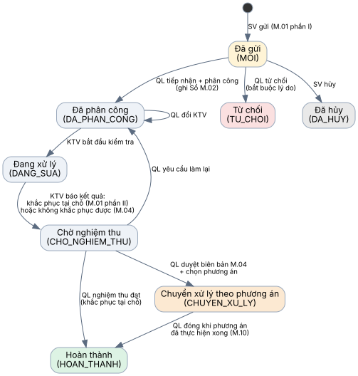
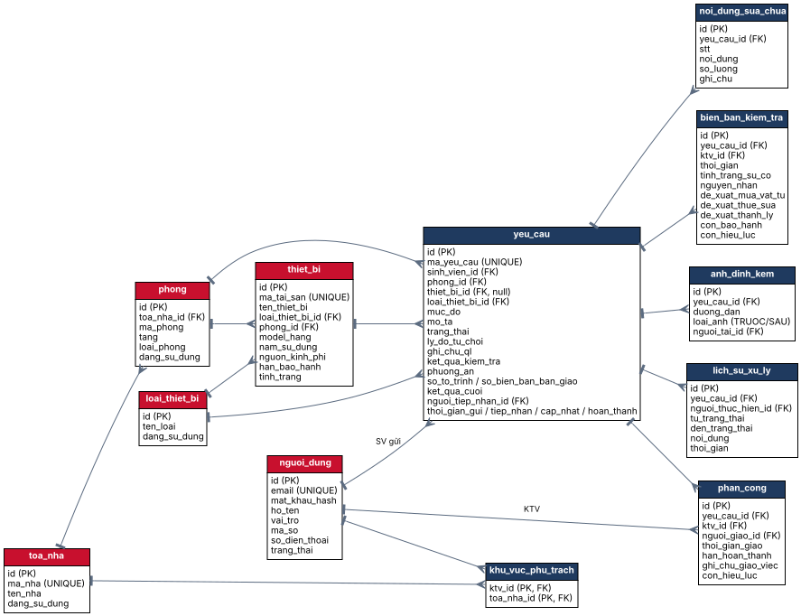

# MÔ TẢ HỆ THỐNG – Hệ thống báo hỏng và quản lý sửa chữa cơ sở vật chất trong trường đại học

> Bài tập lớn ET3260 · Nhóm 4 · Phiên bản 2.1 (22/11/2026) · Đã đối chiếu quy trình QT.06.QT&VT
> Tài liệu đặc tả yêu cầu dùng để code: vai trò, luồng nghiệp vụ, trạng thái, dữ liệu, màn hình và quy tắc kiểm tra.

## 1. Giới thiệu và phạm vi

**Mục đích.** Sinh viên dùng web để báo thiết bị hư hỏng trong phòng học (bàn ghế, máy chiếu, điều hòa…). Phòng quản lý cơ sở vật chất (gọi tắt là *Quản lý*) tiếp nhận và giao việc cho nhân viên kỹ thuật (gọi tắt là *Kỹ thuật viên*). Kỹ thuật viên sửa xong thì báo kết quả, Quản lý nghiệm thu để đóng yêu cầu. Mọi bên theo dõi được tiến độ trên cùng một hệ thống.

**Trong phạm vi (làm):**

- Đăng nhập bằng email trường, 3 vai trò: Sinh viên, Quản lý, Kỹ thuật viên.
- Gửi yêu cầu sửa chữa, theo dõi trạng thái, hủy yêu cầu chưa xử lý.
- Tiếp nhận / từ chối, phân công, sửa chữa, báo kết quả, nghiệm thu.
- Danh mục cơ sở vật chất (nhà, phòng, loại thiết bị, thiết bị) có thêm / sửa / ngừng sử dụng.
- Bảng phân công: khu vực phụ trách của từng kỹ thuật viên và danh sách việc đã giao.
- Lọc, sắp xếp, nhóm yêu cầu theo nhà (D3, D5, C7…).
- Biên bản kiểm tra kỹ thuật khi không khắc phục được tại chỗ, và ghi nhận phương án xử lý (mua vật tư thay thế / thuê đơn vị sửa / đề nghị thanh lý).
- In phiếu và sổ theo biểu mẫu của quy trình (xem mục 9).

**Căn cứ nghiệp vụ.** Luồng xử lý được xây dựng theo **Quy trình sửa chữa, bảo trì trang thiết bị QT.06.QT&VT** (tài liệu "ctnv" của nhóm, ban hành tại Trường ĐH Y Hà Nội) và rút gọn cho phạm vi phòng học. Phần trình duyệt, chọn nhà cung cấp, hợp đồng, thanh toán (bước 3–7 và mẫu M.06–M.11 của quy trình) diễn ra trên giấy, hệ thống chỉ *ghi nhận kết quả*.

| Vai trò trong quy trình QT.06             | Vai trò trong hệ thống                                       |
|-------------------------------------------|--------------------------------------------------------------|
| ĐVSD – đơn vị / người sử dụng thiết bị    | Sinh viên (người phát hiện và báo hỏng)                      |
| CBCT – cán bộ chuyên trách phòng Quản trị | Quản lý (tiếp nhận, ghi sổ, giao việc, nghiệm thu)           |
| CBKT – cán bộ kỹ thuật phòng Quản trị     | Kỹ thuật viên (kiểm tra, khắc phục, lập biên bản kiểm tra)   |
| BGH, P. TCKT, đơn vị cung cấp dịch vụ     | Không có tài khoản; QL ghi lại kết quả phê duyệt / sửa ngoài |

**Ngoài phạm vi (không làm hoặc để sau):** trang chủ giới thiệu, menu avatar, thông tin cá nhân, đổi mật khẩu, trang Hỗ trợ / Liên hệ, chuông thông báo, gửi email tự động, thống kê biểu đồ, quản lý vật tư / kho / chi phí, kế hoạch bảo dưỡng định kỳ (M.05), tờ trình – xét chọn nhà cung cấp – hợp đồng – thanh lý (M.06–M.11).

| Thuật ngữ  | Ý nghĩa                                                         |
|------------|-----------------------------------------------------------------|
| SV         | Sinh viên, người gửi yêu cầu.                                   |
| QL         | Quản lý (cán bộ phòng quản lý cơ sở vật chất), người điều phối. |
| KTV        | Kỹ thuật viên, người trực tiếp sửa chữa.                        |
| Yêu cầu    | Một phiếu báo hỏng do SV gửi, có mã dạng `YC-2026-0001`.        |
| CSVC       | Cơ sở vật chất: nhà, phòng, thiết bị.                           |
| Nghiệm thu | QL kiểm tra kết quả KTV báo và xác nhận hoàn thành.             |

## 2. Các vai trò và phân quyền

Mỗi tài khoản có đúng **một** vai trò, lưu trong cột `vai_tro` của bảng người dùng (giá trị `SINH_VIEN`, `QUAN_LY`, `KY_THUAT_VIEN`). Sau khi đăng nhập, hệ thống tự chuyển đến màn hình của vai trò đó. Người dùng gõ thẳng đường dẫn của vai trò khác sẽ bị chặn (trả về trang "Bạn không có quyền truy cập").

| Chức năng                                      |    SV    |           QL           |         KTV          |
|------------------------------------------------|:--------:|:----------------------:|:--------------------:|
| Gửi yêu cầu sửa chữa                           |    ✔     |           –            |          –           |
| Xem yêu cầu                                    | Của mình |         Tất cả         |  Được giao cho mình  |
| Hủy yêu cầu (khi còn "Đã gửi")                 |    ✔     |           –            |          –           |
| Tiếp nhận + phân công / từ chối                |    –     |           ✔            |          –           |
| Đổi KTV (phân công lại)                        |    –     |           ✔            |          –           |
| Bắt đầu kiểm tra, báo kết quả, tải ảnh sau sửa |    –     |           –            |          ✔           |
| Nghiệm thu / yêu cầu làm lại                   |    –     |           ✔            |          –           |
| Quản lý danh mục CSVC                          |    –     |           ✔            |       Chỉ xem        |
| Quản lý bảng phân công khu vực                 |    –     |           ✔            | Xem khu vực của mình |
| Quản lý tài khoản KTV                          |    –     |           ✔            |          –           |
| In biểu mẫu                                    |   M.01   | M.01, M.02, M.03, M.04 |      M.01, M.04      |
| Lập biên bản kiểm tra kỹ thuật (M.04)          |    –     |       Xem, duyệt       |          ✔           |
| Chuyển phương án, đóng yêu cầu                 |    –     |           ✔            |          –           |

## 3. Đăng nhập bằng email trường

Chỉ có **một** màn hình đăng nhập chung cho cả 3 vai trò (bỏ nút "Đăng nhập với tư cách Người quản lý" trong bản cũ). Người dùng nhập email và mật khẩu, hệ thống đọc vai trò từ tài khoản.

| Vai trò | Email hợp lệ | Cách tạo tài khoản |
|---|---|---|
| Sinh viên | `ho.tenMSSV@sis.hust.edu.vn` (ví dụ `an.nh225001@sis.hust.edu.vn`) | Nạp sẵn (dữ liệu mẫu / import danh sách). MSSV lưu riêng ở cột `ma_so`. |
| Quản lý | `…@hust.edu.vn` | Nạp sẵn trong dữ liệu mẫu. |
| Kỹ thuật viên | `…@hust.edu.vn` | QL tạo trên màn hình Quản lý KTV. |

**Luồng xử lý:**

1.  Kiểm tra định dạng email; đuôi phải là `@sis.hust.edu.vn` hoặc `@hust.edu.vn`. Sai → báo "Vui lòng dùng email trường (@hust.edu.vn hoặc @sis.hust.edu.vn)".
2.  Tìm tài khoản theo email. Không có hoặc sai mật khẩu → báo chung "Email hoặc mật khẩu không đúng" (không nói rõ sai cái nào).
3.  Tài khoản bị khóa (`trang_thai = KHOA`) → báo "Tài khoản đã bị khóa, vui lòng liên hệ phòng quản lý".
4.  Đúng → tạo phiên đăng nhập và chuyển trang theo vai trò: SV → *Yêu cầu của tôi*; QL → *Danh sách yêu cầu*; KTV → *Việc được giao*.

> **Ghi chú:** Vai trò **không** suy ra từ đuôi email vì QL và KTV cùng dùng `@hust.edu.vn`; đuôi email chỉ dùng để chặn email ngoài trường. Nếu nhóm muốn "Đăng nhập bằng Google" thật thì có thể làm sau, chỉ cần thay bước 1–2 bằng Google OAuth giới hạn tên miền, phần còn lại giữ nguyên. Mật khẩu phải lưu dạng băm (bcrypt), không lưu chữ thường.

## 4. Quy trình nghiệp vụ tổng thể

Luồng dưới đây bám theo lưu đồ của QT.06 (bước 1 "Đề nghị xử lý sự cố" → bước 2 "Kiểm tra, xác định, khắc phục sự cố" → *khắc phục tại chỗ* thì kết thúc, *không khắc phục tại chỗ* thì lập biên bản kiểm tra kỹ thuật và chuyển phương án). Mỗi bước đều ghi một dòng vào **lịch sử xử lý** (ai, lúc nào, đổi từ trạng thái nào sang trạng thái nào, nội dung).

| \#  | Ai  | Việc làm                                                                                                                                                                                                                                                                                           | Ứng với QT.06         | Trạng thái sau bước         |
|-----|-----|----------------------------------------------------------------------------------------------------------------------------------------------------------------------------------------------------------------------------------------------------------------------------------------------------|-----------------------|-----------------------------|
| 1   | SV  | Chọn Nhà → Phòng → Thiết bị (hoặc chọn loại thiết bị nếu không có trong danh sách), chọn mức độ, mô tả tình trạng hư hỏng, đính kèm ảnh, bấm **Gửi yêu cầu**. Hệ thống sinh mã `YC-năm-số`.                                                                                                        | Bước 1 · M.01 phần I  | Đã gửi                      |
| 2a  | QL  | Xem yêu cầu mới. Nếu hợp lệ: bấm **Tiếp nhận & phân công**, chọn KTV (hệ thống gợi ý KTV phụ trách nhà đó), hạn kiểm tra, ghi chú giao việc. Yêu cầu tự vào **Sổ tiếp nhận thông báo sự cố**.                                                                                                      | Bước 1 · M.02         | Đã phân công                |
| 2b  | QL  | Nếu không hợp lệ (trùng, báo sai, không thuộc phạm vi): bấm **Từ chối**, bắt buộc nhập lý do. SV thấy lý do ở trang chi tiết.                                                                                                                                                                      | –                     | Từ chối (kết thúc)          |
| 2c  | SV  | Khi yêu cầu còn "Đã gửi", SV có thể **Hủy**.                                                                                                                                                                                                                                                       | –                     | Đã hủy (kết thúc)           |
| 3   | KTV | Thấy việc trong "Việc được giao", đến hiện trường, bấm **Bắt đầu kiểm tra**. Theo QT.06, việc kiểm tra phải xong trong **01 ngày làm việc**.                                                                                                                                                       | Bước 2                | Đang xử lý                  |
| 4a  | KTV | **Khắc phục được tại chỗ:** bấm **Báo kết quả** → chọn *Đã khắc phục tại chỗ*, nhập các dòng "Nội dung sửa chữa – Số lượng – Ghi chú" (đúng phần II của M.01), ảnh sau sửa (không bắt buộc).                                                                                                       | Bước 2 · M.01 phần II | Chờ nghiệm thu              |
| 4b  | KTV | **Không khắc phục được tại chỗ:** chọn *Không khắc phục tại chỗ* và điền **Biên bản kiểm tra kỹ thuật**: tình trạng sự cố, nguyên nhân, biện pháp đề nghị (Mua vật tư thay thế / Thuê đơn vị sửa chữa / Hỏng – đề nghị thanh lý; có thể chọn nhiều, mỗi mục ghi chi tiết), còn bảo hành hay không. | Bước 2 · M.04         | Chờ nghiệm thu              |
| 5a  | QL  | Với kết quả 4a: bấm **Nghiệm thu đạt**. Hệ thống điền "Ngày hoàn thành xử lý" vào sổ M.02 và cập nhật thiết bị (mục 6.3).                                                                                                                                                                          | Bước 2 (kết thúc)     | Hoàn thành                  |
| 5b  | QL  | Với kết quả 4b: xem biên bản, bấm **Duyệt biên bản & chuyển phương án**, chọn phương án chính (Bảo hành / Mua vật tư thay thế / Thuê đơn vị sửa / Thanh lý – mua mới), số tờ trình hoặc ghi chú. Phần trình BGH, chọn nhà cung cấp, hợp đồng làm trên giấy.                                        | Bước 3–4 · M.06       | Chuyển xử lý theo phương án |
| 5c  | QL  | Kết quả chưa đạt / biên bản thiếu: bấm **Yêu cầu làm lại** (bắt buộc ghi lý do), giữ KTV cũ hoặc đổi KTV khác.                                                                                                                                                                                     | –                     | Đã phân công                |
| 6   | QL  | Khi phương án đã thực hiện xong ngoài hệ thống (đã thay, đã sửa ngoài, đã thanh lý): bấm **Đóng yêu cầu**, ghi kết quả và số biên bản nghiệm thu bàn giao (M.10) nếu có.                                                                                                                           | Bước 5–7 · M.10       | Hoàn thành                  |

> **Vì sao gộp "Tiếp nhận" với "Phân công"?** Theo QT.06, ngay khi tiếp nhận thì CBKT đi kiểm tra; tiếp nhận mà chưa giao cho ai không có ý nghĩa. Gộp lại giúp ít nút, ít trạng thái, dễ code. Với SV, "Đã phân công" hiển thị là *"Đã tiếp nhận"*.

## 5. Trạng thái yêu cầu (máy trạng thái)

Hình 1. Các trạng thái của một yêu cầu, người được phép chuyển trạng thái và biểu mẫu tương ứng

| Mã (lưu CSDL)    | Tên hiển thị cho QL/KTV     | Tên hiển thị cho SV           | Màu nhãn gợi ý  |
|------------------|-----------------------------|-------------------------------|-----------------|
| `MOI`            | Đã gửi                      | Đã gửi                        | Vàng            |
| `DA_PHAN_CONG`   | Đã phân công                | Đã tiếp nhận                  | Xanh dương nhạt |
| `DANG_SUA`       | Đang xử lý                  | Đang xử lý                    | Xanh dương      |
| `CHO_NGHIEM_THU` | Chờ nghiệm thu              | Đang xử lý                    | Tím             |
| `CHUYEN_XU_LY`   | Chuyển xử lý theo phương án | Chờ thay thế / sửa chữa ngoài | Cam             |
| `HOAN_THANH`     | Hoàn thành                  | Đã hoàn thành                 | Xanh lá         |
| `TU_CHOI`        | Từ chối                     | Bị từ chối                    | Đỏ              |
| `DA_HUY`         | Đã hủy                      | Đã hủy                        | Xám             |

### 5.1 Bảng chuyển trạng thái (dùng để code kiểm tra)

| Từ             | Sang           | Ai               | Hành động                         | Bắt buộc nhập                                                                                               |
|----------------|----------------|------------------|-----------------------------------|-------------------------------------------------------------------------------------------------------------|
| MOI            | DA_PHAN_CONG   | QL               | Tiếp nhận & phân công             | KTV; hạn kiểm tra                                                                                           |
| MOI            | TU_CHOI        | QL               | Từ chối                           | Lý do từ chối                                                                                               |
| MOI            | DA_HUY         | SV (chủ yêu cầu) | Hủy yêu cầu                       | –                                                                                                           |
| DA_PHAN_CONG   | DA_PHAN_CONG   | QL               | Đổi KTV                           | KTV mới                                                                                                     |
| DA_PHAN_CONG   | DANG_SUA       | KTV được giao    | Bắt đầu kiểm tra                  | –                                                                                                           |
| DANG_SUA       | CHO_NGHIEM_THU | KTV được giao    | Báo kết quả                       | Kết quả; nếu khắc phục tại chỗ: ≥1 dòng nội dung sửa chữa; nếu không: tình trạng, nguyên nhân, ≥1 biện pháp |
| CHO_NGHIEM_THU | HOAN_THANH     | QL               | Nghiệm thu đạt                    | Chỉ khi kết quả = khắc phục tại chỗ                                                                         |
| CHO_NGHIEM_THU | CHUYEN_XU_LY   | QL               | Duyệt biên bản & chuyển phương án | Chỉ khi kết quả = không khắc phục tại chỗ; phương án                                                        |
| CHO_NGHIEM_THU | DA_PHAN_CONG   | QL               | Yêu cầu làm lại                   | Lý do; KTV (mặc định KTV cũ)                                                                                |
| CHUYEN_XU_LY   | HOAN_THANH     | QL               | Đóng yêu cầu                      | Kết quả xử lý; tình trạng thiết bị sau cùng                                                                 |

Mọi chuyển trạng thái **không có** trong bảng trên đều bị từ chối ở phía server (ví dụ KTV không thể đẩy thẳng từ "Đã phân công" sang "Hoàn thành"). Nút nào không hợp lệ với trạng thái hiện tại thì ẩn đi trên giao diện.

## 6. Danh mục cơ sở vật chất

Danh mục gồm 4 cấp, do QL thêm / sửa / ngừng sử dụng. Mục đích: SV chọn từ danh sách thay vì gõ tay, nên dữ liệu đồng nhất và lọc theo nhà được.

| Danh mục      | Thông tin                                                                                                                                        | Ví dụ                                                                           |
|---------------|--------------------------------------------------------------------------------------------------------------------------------------------------|---------------------------------------------------------------------------------|
| Nhà (tòa nhà) | Mã nhà (duy nhất), tên nhà, đang sử dụng                                                                                                         | D3, D5, D9, C7, TC (Thư viện Tạ Quang Bửu)                                      |
| Phòng         | Thuộc nhà, mã phòng, tầng, loại phòng (học / thí nghiệm / hội trường…), đang sử dụng                                                             | D3-301, D5-204, C7-102                                                          |
| Loại thiết bị | Tên loại, đang sử dụng                                                                                                                           | Bàn ghế, Bảng, Cửa, Máy chiếu, TV, Quạt, Điều hòa, Đèn, Ổ điện, Loa/Micro, Khác |
| Thiết bị      | Mã tài sản (duy nhất), tên, loại, model – hãng sản xuất, năm sử dụng, nguồn kinh phí, phòng đặt, tình trạng, hạn bảo hành (theo cột của sổ M.03) | MC-D3301-01: Máy chiếu Epson EB-X51, D3-301                                     |

### 6.1 Quy tắc thêm / bớt

- **Thêm:** mã nhà, mã phòng (trong cùng một nhà), mã tài sản không được trùng.
- **Bớt:** không xóa hẳn mục đã có yêu cầu liên quan (để giữ lịch sử). Thay vào đó đặt *Ngừng sử dụng*; mục ngừng sử dụng không hiện trong form của SV nhưng vẫn hiện trong yêu cầu cũ. Mục chưa từng được dùng thì được xóa hẳn.
- Không cho ngừng sử dụng một nhà khi còn phòng đang sử dụng trong nhà đó (phải ngừng phòng trước), tương tự phòng với thiết bị.
- Có thể nhập nhanh nhiều dòng bằng file Excel/CSV (tùy chọn, làm sau).

### 6.2 Tình trạng thiết bị

`HOAT_DONG` (Hoạt động) · `DANG_SUA` (Đang sửa) · `CHO_THAY_THE` (Hỏng – chờ thay thế) · `THANH_LY` (Đã thanh lý, coi như ngừng sử dụng).

### 6.3 Tình trạng thiết bị tự cập nhật theo yêu cầu

| Khi yêu cầu (có gắn thiết bị cụ thể)…  | Tình trạng thiết bị đổi thành                                 |
|----------------------------------------|---------------------------------------------------------------|
| Chuyển sang Đang xử lý                 | Đang sửa                                                      |
| Hoàn thành sau khi khắc phục tại chỗ   | Hoạt động                                                     |
| Chuyển xử lý theo phương án            | Hỏng – chờ thay thế                                           |
| Đóng yêu cầu ở trạng thái Chuyển xử lý | QL chọn: Hoạt động (đã sửa / thay linh kiện) hoặc Đã thanh lý |
| Bị từ chối / hủy                       | Giữ nguyên                                                    |

QL vẫn sửa tay được tình trạng thiết bị trên màn hình danh mục (ví dụ khi đã thay thiết bị mới).

## 7. Phân công sửa chữa và phân chia theo nhà

"Bảng phân công" gồm **hai phần** liên quan với nhau:

### 7.1 Bảng khu vực phụ trách (KTV ↔ Nhà)

QL gán mỗi KTV phụ trách một hoặc nhiều nhà. Một nhà có thể có nhiều KTV. Bảng này dùng để **gợi ý** người khi phân công, không ép buộc.

| Kỹ thuật viên | Nhà phụ trách | Việc đang làm |
|---------------|---------------|---------------|
| Trần Văn Bình | D3, D5        | 3             |
| Lê Thị Hoa    | D9, C7        | 1             |
| Phạm Minh Đức | TC, D3        | 0             |

"Việc đang làm" = số yêu cầu của KTV đó đang ở trạng thái Đã phân công hoặc Đang xử lý (tính tự động).

### 7.2 Danh sách phân công công việc

Mỗi lần QL giao việc tạo một bản ghi phân công: yêu cầu, KTV, người giao, thời gian giao, hạn hoàn thành, ghi chú giao việc. Khi QL đổi KTV hoặc yêu cầu làm lại, bản ghi cũ được đánh dấu *hết hiệu lực* và tạo bản ghi mới, nhờ đó xem lại được ai đã từng nhận việc. Mỗi yêu cầu chỉ có **một** bản ghi đang hiệu lực.

### 7.3 Gợi ý KTV khi phân công

1.  Lấy nhà của phòng trong yêu cầu.
2.  Danh sách KTV hiển thị theo thứ tự: KTV phụ trách nhà đó trước, trong nhóm này ai ít việc đang làm hơn xếp trước; sau đó đến các KTV còn lại.
3.  Mỗi dòng ghi rõ "Phụ trách D3 · đang làm 2 việc". QL tự chọn.

### 7.4 Sắp xếp / lọc / nhóm theo nhà

- Màn hình danh sách yêu cầu (QL) có bộ lọc **Nhà** (chọn nhiều) và nút chuyển chế độ **"Xem theo nhà"**: các yêu cầu được nhóm thành từng khối D3, D5, C7…, tiêu đề mỗi khối ghi số yêu cầu chưa xong.
- Thanh tóm tắt phía trên: số yêu cầu chưa xử lý theo từng nhà (ví dụ *D3: 5 · D5: 2 · C7: 0*), bấm vào để lọc nhanh.
- Màn hình của KTV mặc định nhóm việc theo nhà để đi sửa một lượt trong cùng một tòa.
- Cột Phòng luôn hiển thị dạng `Nhà-Phòng` (D3-301) để sắp xếp đúng.

## 8. Đặc tả màn hình

**Khung giao diện chung** (theo 3 ảnh mẫu trong Project, phong cách web HUST): thanh đầu trang màu đỏ có logo BK, tên hệ thống, bên phải là *họ tên – vai trò* và nút **Đăng xuất**. Dưới đó là thanh menu ngắn theo vai trò (không có Trang chủ, Hỗ trợ, Liên hệ, avatar). Giao diện phải dùng được trên điện thoại (bảng chuyển thành thẻ khi màn hình hẹp).

| Mã  | Màn hình                  | Vai trò | Menu / cách vào                                  |
|-----|---------------------------|---------|--------------------------------------------------|
| M01 | Đăng nhập                 | Tất cả  | Trang mặc định khi chưa đăng nhập                |
| S01 | Yêu cầu của tôi           | SV      | Menu "Yêu cầu của tôi" (trang đầu sau đăng nhập) |
| S02 | Gửi yêu cầu mới           | SV      | Menu "Gửi yêu cầu" hoặc nút trên S01             |
| S03 | Chi tiết yêu cầu (SV)     | SV      | Bấm một dòng trong S01                           |
| Q01 | Danh sách yêu cầu         | QL      | Menu "Yêu cầu" (trang đầu sau đăng nhập)         |
| Q02 | Chi tiết & xử lý yêu cầu  | QL      | Bấm "Xem" trong Q01                              |
| Q03 | Bảng phân công            | QL      | Menu "Phân công"                                 |
| Q04 | Danh mục CSVC             | QL      | Menu "Cơ sở vật chất" (4 tab)                    |
| Q05 | Quản lý KTV               | QL      | Menu "Kỹ thuật viên"                             |
| Q06 | Sổ tiếp nhận sự cố (M.02) | QL      | Menu "Sổ tiếp nhận"                              |
| K01 | Việc được giao            | KTV     | Menu "Việc của tôi" (trang đầu sau đăng nhập)    |
| K02 | Chi tiết công việc        | KTV     | Bấm một việc trong K01                           |

### M01 – Đăng nhập

    ┌──────────────── [ảnh nền background.webp] ────────────────┐
    │        [logo BK]  HỆ THỐNG BÁO HỎNG & SỬA CHỮA CSVC          │
    │        Email trường   [ ten.mssv@sis.hust.edu.vn        ]    │
    │        Mật khẩu       [ ••••••••                    👁 ]    │
    │                       [        ĐĂNG NHẬP        ]            │
    │        Dùng email @sis.hust.edu.vn (SV) hoặc @hust.edu.vn    │
    └──────────────────────────────────────────────────────────────┘

Kiểm tra và thông báo lỗi theo mục 3. Bấm Enter cũng đăng nhập.

### S01 – Yêu cầu của tôi (SV)

- Nút **+ Gửi yêu cầu mới** ở góc trên.
- Bảng cột: Mã yêu cầu · Thời gian gửi · Mức độ · Thiết bị · Phòng (D3-301) · Trạng thái (nhãn màu) · Ghi chú của QL. Mới nhất xếp trên.
- Lọc theo trạng thái (Tất cả / Đang xử lý / Đã xong / Từ chối – Hủy). Phân trang 10 dòng.
- Chưa có yêu cầu nào → hiện "Bạn chưa gửi yêu cầu nào" và nút gửi.

### S02 – Gửi yêu cầu mới (SV)

| Trường              | Kiểu           | Quy tắc                                                                                                                               |
|---------------------|----------------|---------------------------------------------------------------------------------------------------------------------------------------|
| MSSV, Họ tên, Email | Chỉ đọc        | Tự điền từ tài khoản.                                                                                                                 |
| Nhà                 | Danh sách chọn | Bắt buộc. Chỉ các nhà đang sử dụng.                                                                                                   |
| Phòng               | Danh sách chọn | Bắt buộc. Chỉ hiện phòng thuộc nhà đã chọn; đổi nhà thì xóa lựa chọn phòng.                                                           |
| Thiết bị            | Danh sách chọn | Hiện thiết bị trong phòng đã chọn (dạng "Máy chiếu – MC-D3301-01") và dòng cuối *"Không có trong danh sách"*. Bắt buộc chọn một dòng. |
| Loại thiết bị       | Danh sách chọn | Tự điền và khóa khi chọn thiết bị cụ thể; bắt buộc chọn tay khi chọn "Không có trong danh sách".                                      |
| Mức độ              | Chọn 1 trong 2 | Bắt buộc: *Khẩn cấp* (ảnh hưởng buổi học / an toàn) hoặc *Bình thường*. Có dòng giải thích nhỏ bên dưới.                              |
| Mô tả hư hỏng       | Ô văn bản      | Bắt buộc, 10–1000 ký tự. Gợi ý: "Máy chiếu bật không lên hình, đèn báo nhấp nháy đỏ".                                                 |
| Ảnh đính kèm        | Tải tệp        | Bắt buộc ít nhất 1 ảnh, tối đa 3 ảnh; JPG/PNG; mỗi ảnh ≤ 5 MB. Hiện ảnh xem trước, có nút xóa.                                        |

- Trường bắt buộc để trống → viền đỏ và dòng "Mục này không được để trống" ngay dưới trường; con trỏ nhảy đến lỗi đầu tiên.
- **Cảnh báo trùng:** nếu thiết bị (hoặc cùng phòng + cùng loại) đang có yêu cầu chưa kết thúc → hiện "Thiết bị này đã được báo hỏng (YC-2026-0012, Đang xử lý). Bạn vẫn muốn gửi?" với nút *Vẫn gửi* / *Hủy*.
- Bấm **Gửi yêu cầu** → nút bị khóa trong lúc gửi (tránh gửi 2 lần) → cửa sổ nổi trên nền mờ: *"Yêu cầu YC-2026-0035 đã được gửi! Bạn có thể theo dõi trạng thái ở mục Yêu cầu của tôi."*, có nút **✕** và **Xem yêu cầu**. Đóng cửa sổ thì form được làm trống.

### S03 – Chi tiết yêu cầu (SV)

- Toàn bộ thông tin đã gửi, ảnh (bấm để phóng to), trạng thái hiện tại, ghi chú của QL, lý do từ chối (nếu có), kết quả sửa và ảnh sau sửa (khi hoàn thành).
- Dòng thời gian tiến độ rút gọn: Đã gửi → Đã tiếp nhận → Đang xử lý → Đã hoàn thành (hoặc "Chờ thay thế / sửa chữa ngoài" kèm phương án), không hiện tên KTV.
- Nút **Hủy yêu cầu** chỉ hiện khi trạng thái là Đã gửi; bấm thì hỏi xác nhận. Nút **In phiếu yêu cầu (M.01)**.

### Q01 – Danh sách yêu cầu (QL)

    [ Mới 6 ] [ Đã phân công 4 ] [ Đang sửa 3 ] [ Chờ nghiệm thu 2 ] [ Hoàn thành (tháng) 21 ]
    Theo nhà:  D3: 5 · D5: 2 · D9: 1 · C7: 0 · TC: 3
    Lọc: Nhà [D3,D5▾]  Trạng thái [▾]  Mức độ [▾]  Từ ngày [  ] đến [  ]  Tìm [mã/MSSV/phòng]
    Sắp xếp: (•) Khẩn cấp lên đầu ( ) Mới nhất      Chế độ: [Danh sách | Theo nhà]
    ┌────────────┬───────────┬────────┬──────────┬────────┬──────────┬────────┬───────────┬────────┐
    │ Mã         │ Gửi lúc   │ Mức độ │ Thiết bị │ Phòng  │ SV       │ KTV    │ Trạng thái│        │
    ├────────────┼───────────┼────────┼──────────┼────────┼──────────┼────────┼───────────┼────────┤
    │ YC-2026-35 │ 22/11 9:10│ ⚠ KC   │ Máy chiếu│ D3-301 │ N.H. An  │ –      │ Đã gửi    │ [Xem]  │
    └────────────┴───────────┴────────┴──────────┴────────┴──────────┴────────┴───────────┴────────┘
                                       « 1 2 3 »   (15 dòng/trang)

- 5 ô số liệu ở trên cùng; bấm ô nào thì lọc theo trạng thái đó.
- Dòng **Khẩn cấp** có nền đỏ nhạt và biểu tượng ⚠. Dòng quá hạn hoàn thành có chữ "Quá hạn" màu đỏ ở cột KTV.
- Bộ lọc thời gian: chọn khoảng ngày; có nút nhanh *Tháng này*, *Học kỳ này*, *Năm nay*.
- Chế độ "Theo nhà" như mục 7.4. Nút **Xuất Excel** danh sách đang lọc (làm sau).

### Q02 – Chi tiết & xử lý yêu cầu (QL)

Trang chia 3 khối:

1.  **Thông tin yêu cầu** (chỉ đọc): mã, thời gian gửi, SV (MSSV, họ tên, email), nhà – phòng, thiết bị (mã tài sản, tình trạng), loại, mức độ, mô tả, ảnh. Có liên kết "Các yêu cầu khác của thiết bị/phòng này".
2.  **Khối xử lý**: nút hiển thị tùy trạng thái.

    | Trạng thái hiện tại                      | QL thấy gì                                                                                                                                                                                                                            |
    |------------------------------------------|---------------------------------------------------------------------------------------------------------------------------------------------------------------------------------------------------------------------------------------|
    | Đã gửi                                   | Nút **Tiếp nhận & phân công** (mở hộp chọn KTV theo gợi ý ở mục 7.3; hạn kiểm tra mặc định theo QT.06: Khẩn cấp = trong ngày, Bình thường = 01 ngày làm việc; ghi chú giao việc; ghi chú cho SV) và nút **Từ chối** (hộp nhập lý do). |
    | Đã phân công                             | KTV hiện tại, hạn; nút **Đổi KTV**.                                                                                                                                                                                                   |
    | Đang xử lý                               | Chỉ xem; có thể cập nhật *Ghi chú cho SV*.                                                                                                                                                                                            |
    | Chờ nghiệm thu – khắc phục tại chỗ       | Bảng nội dung sửa chữa (M.01 phần II), ảnh sau sửa; nút **Nghiệm thu đạt** và **Yêu cầu làm lại**.                                                                                                                                    |
    | Chờ nghiệm thu – không khắc phục tại chỗ | Biên bản kiểm tra kỹ thuật (M.04) do KTV lập; nút **Duyệt biên bản & chuyển phương án** (chọn phương án: Bảo hành / Mua vật tư thay thế / Thuê đơn vị sửa / Thanh lý – mua mới; số tờ trình M.06 nếu có) và **Yêu cầu làm lại**.      |
    | Chuyển xử lý theo phương án              | Phương án đã chọn; nút **Đóng yêu cầu** (nhập kết quả, số biên bản M.10 nếu có, tình trạng thiết bị sau cùng).                                                                                                                        |
    | Hoàn thành / Từ chối / Hủy               | Chỉ xem.                                                                                                                                                                                                                              |

3.  **Lịch sử xử lý**: bảng thời gian · người thực hiện · thao tác · nội dung. Nút **Quay lại danh sách** (giữ nguyên bộ lọc đang dùng) và các nút in phiếu.

Mỗi thao tác thành công → hiện thông báo "Đã cập nhật yêu cầu YC-…!" và tải lại khối xử lý.

### Q03 – Bảng phân công (QL)

- **Tab "Khu vực phụ trách":** bảng ở mục 7.1. Mỗi dòng có nút **Sửa** mở hộp chọn nhiều nhà (ô đánh dấu). Có thể xem ngược theo nhà: nhà nào chưa có KTV phụ trách thì tô cảnh báo.
- **Tab "Công việc đã giao":** danh sách bản ghi phân công đang hiệu lực: Mã yêu cầu · Phòng · KTV · Giao lúc · Hạn · Trạng thái · Quá hạn? Lọc theo KTV, nhà, trạng thái. Có thể bật "Hiện cả bản ghi cũ" để xem lịch sử đổi người.

### Q04 – Danh mục CSVC (QL)

4 tab: **Nhà · Phòng · Loại thiết bị · Thiết bị**. Mỗi tab là một bảng có ô tìm kiếm, nút **+ Thêm**, mỗi dòng có **Sửa** và **Ngừng sử dụng / Xóa** theo quy tắc mục 6.1. Tab Phòng lọc theo nhà; tab Thiết bị lọc theo nhà, phòng, loại, tình trạng và có cột "Số lần sửa chữa". Bấm vào một thiết bị mở **Hồ sơ thiết bị**: thông tin như cột 1–7 của sổ M.03 và bảng lịch sử sửa chữa (ngày, nội dung đã sửa, KTV, kết quả) – tương ứng cột 8 "Sửa chữa (số lần và nội dung đã sửa chữa)" của M.03.

### Q05 – Quản lý KTV (QL)

Danh sách KTV (họ tên, email, số điện thoại, nhà phụ trách, việc đang làm, trạng thái). Thêm KTV (email phải đuôi `@hust.edu.vn`, đặt mật khẩu ban đầu), sửa, khóa / mở khóa. Không khóa được KTV còn việc đang làm (phải đổi người trước).

### Q06 – Sổ tiếp nhận thông báo sự cố (QL)

Bảng đúng cột của mẫu M.02, sinh tự động từ các yêu cầu đã tiếp nhận (không gồm yêu cầu bị từ chối / hủy): STT · Ngày tháng · Thiết bị gặp sự cố · Đơn vị sử dụng · Tình trạng sự cố · Xác nhận · Ngày hoàn thành xử lý sự cố · Ghi chú. Lọc theo khoảng ngày và nhà; nút **In sổ** (trang in ngang A4, tiêu đề "SỔ TIẾP NHẬN THÔNG BÁO SỰ CỐ", ký hiệu M.02) và **Xuất Excel**. Không có ô sửa: muốn đổi nội dung thì sửa ở yêu cầu.

### K01 – Việc được giao (KTV)

- Mặc định nhóm theo nhà; trong mỗi nhà xếp Khẩn cấp trước, rồi hạn gần trước.
- Mỗi việc dạng thẻ: Mã · Phòng · Thiết bị · Mức độ · Hạn (đỏ nếu quá hạn) · Trạng thái · nút **Xem**.
- Tab: *Cần làm* (Đã phân công + Đang xử lý) · *Chờ nghiệm thu* · *Đã xong* (gồm cả Chuyển xử lý theo phương án).

### K02 – Chi tiết công việc (KTV)

- Thông tin yêu cầu (như Q02 khối 1, không hiện email SV), ghi chú giao việc của QL, lý do làm lại (nếu có).
- Trạng thái Đã phân công → nút **Bắt đầu kiểm tra**.
- Trạng thái Đang xử lý → nút **Báo kết quả**, chọn một trong hai:
  - *Đã khắc phục tại chỗ*: bảng nhập nhiều dòng **Nội dung sửa chữa · Số lượng · Ghi chú** (ít nhất 1 dòng, ví dụ "Thay bóng đèn máy chiếu · 1 · bóng dự phòng kho"); ảnh sau sửa (không bắt buộc, tối đa 3).
  - *Không khắc phục tại chỗ*: form **Biên bản kiểm tra kỹ thuật**: Tình trạng sự cố (bắt buộc), Nguyên nhân (bắt buộc), Biện pháp đề nghị (đánh dấu ít nhất 1: Mua vật tư thay thế / Thuê đơn vị sửa chữa / Hỏng – đề nghị thanh lý, mỗi mục có ô ghi chi tiết), Thiết bị còn bảo hành? (Có / Không).
- Nút **In M.01** (khi đã có phần II) và **In M.04** (khi đã lập biên bản).

## 9. Biểu mẫu áp dụng (đối chiếu QT.06.QT&VT)

Quy trình QT.06 có 11 biểu mẫu. Bảng dưới cho biết mẫu nào hệ thống **sinh tự động** (bấm nút → trang in A4 → in / lưu PDF bằng trình duyệt), mẫu nào chỉ **ghi nhận số hiệu**, mẫu nào **ngoài phạm vi**. Trên trang in, phần đầu đổi "TRƯỜNG ĐẠI HỌC Y HÀ NỘI" thành "ĐẠI HỌC BÁCH KHOA HÀ NỘI", giữ nguyên ký hiệu mẫu để dẫn chiếu trong báo cáo.

| Ký hiệu   | Tên biểu mẫu                                                   | Mức áp dụng      | Cách hệ thống tạo / lấy dữ liệu                                                                                                                                                                                                                                                                                                                                                                                                                                                                                                                |
|-----------|----------------------------------------------------------------|------------------|------------------------------------------------------------------------------------------------------------------------------------------------------------------------------------------------------------------------------------------------------------------------------------------------------------------------------------------------------------------------------------------------------------------------------------------------------------------------------------------------------------------------------------------------|
| M.01      | Phiếu yêu cầu sửa chữa trang thiết bị                          | **Sinh tự động** | **Phần I – Phần đề nghị của đơn vị**: "Đơn vị" = nhà – phòng; người đề nghị = họ tên, MSSV; bảng STT · *Nội dung cần sửa chữa* (thiết bị + mã tài sản) · *Tình trạng hư hỏng* (mô tả SV) · *Ghi chú* (mức độ); ngày gửi. Ô ký "Trưởng đơn vị" đổi thành "Người đề nghị". **Phần II – Phần sửa chữa và nghiệm thu**: các dòng KTV nhập ở bước 4a (*Nội dung sửa chữa · Số lượng · Ghi chú*); ký: Cán bộ kỹ thuật (KTV) · Đơn vị sử dụng · Phòng QT (QL nghiệm thu). Có thể in ngay sau khi gửi (phần II để trống) và in lại sau khi hoàn thành. |
| M.02      | Sổ tiếp nhận thông báo sự cố                                   | **Sinh tự động** | Màn hình Q06 (mục 8). Mỗi yêu cầu đã tiếp nhận là một dòng: STT · Ngày tháng (ngày tiếp nhận) · Thiết bị gặp sự cố · Đơn vị sử dụng (nhà – phòng) · Tình trạng sự cố · Xác nhận (tên QL tiếp nhận) · Ngày hoàn thành xử lý sự cố · Ghi chú (kết quả / phương án). Lọc theo khoảng ngày, nhà; in hoặc xuất Excel.                                                                                                                                                                                                                               |
| M.03      | Sổ theo dõi hiệu quả sử dụng trang thiết bị                    | Một phần         | Lấy cột 1–8 (Tên thiết bị, Model – Hãng, Số lượng, Năm sử dụng, Nguồn kinh phí, Hiện trạng, Sửa chữa: số lần và nội dung) từ danh mục thiết bị và lịch sử sửa chữa → hiển thị ở **Hồ sơ thiết bị** (Q04), in được theo phòng / nhà. Cột 9–15 (điều kiện vận hành, hiệu quả sử dụng cho giảng dạy / NCKH…) không làm.                                                                                                                                                                                                                           |
| M.04      | Biên bản kiểm tra kỹ thuật                                     | **Sinh tự động** | Từ dữ liệu KTV nhập ở bước 4b: thời gian, địa điểm (nhà – phòng); thành phần: QL, KTV, đại diện đơn vị đề nghị (SV báo hỏng); tên máy, ký hiệu (mã tài sản), nơi đặt, năm sử dụng; *Tình trạng sự cố*; *Nguyên nhân*; *Biện pháp đề nghị xử lý*: Mua vật tư thay thế / Thuê đơn vị sửa chữa / Hỏng, đề nghị thanh lý. Ô ký giữ như mẫu.                                                                                                                                                                                                        |
| M.05      | Kế hoạch bảo trì, bảo dưỡng                                    | Ngoài phạm vi    | Thuộc nhánh bảo dưỡng định kỳ; để phát triển sau (danh sách thiết bị theo chu kỳ, 12 tháng).                                                                                                                                                                                                                                                                                                                                                                                                                                                   |
| M.06      | Tờ trình đề nghị phương án xử lý                               | Ghi nhận         | Khi QL "Duyệt biên bản & chuyển phương án" (bước 5b): nhập số tờ trình (không bắt buộc) và phương án; hệ thống không soạn tờ trình.                                                                                                                                                                                                                                                                                                                                                                                                            |
| M.07–M.09 | Biên bản xét chọn ĐVCC, Quyết định phê duyệt, Hợp đồng dịch vụ | Ngoài phạm vi    | Thủ tục mua sắm, phê duyệt của BGH theo giá trị hợp đồng, làm trên giấy.                                                                                                                                                                                                                                                                                                                                                                                                                                                                       |
| M.10      | Biên bản bàn giao, nghiệm thu dịch vụ                          | Ghi nhận         | Khi QL "Đóng yêu cầu" từ trạng thái Chuyển xử lý (bước 6): nhập số biên bản và nội dung đã thực hiện.                                                                                                                                                                                                                                                                                                                                                                                                                                          |
| M.11      | Biên bản nghiệm thu thanh lý hợp đồng                          | Ngoài phạm vi    | Thủ tục thanh toán với P. TCKT.                                                                                                                                                                                                                                                                                                                                                                                                                                                                                                                |

**Thay đổi so với bản 2.0:** bỏ "Phiếu giao việc" và "Biên bản nghiệm thu sửa chữa" tự đặt; thay bằng M.01 hai phần, M.02 và M.04 đúng theo quy trình. Thông tin giao việc (KTV, hạn) vẫn xem được ở Q02/K02 và trong cột Ghi chú của sổ M.02.

> **Lưu ý khi viết báo cáo:** QT.06 là quy trình của Trường ĐH Y Hà Nội, áp dụng cho mọi đơn vị (khoa, bộ môn…). Nhóm dùng làm quy trình tham chiếu và nói rõ hai điểm điều chỉnh: (1) người báo hỏng là sinh viên thay cho lãnh đạo đơn vị sử dụng; (2) hệ thống số hóa nhánh "sửa chữa đột xuất" (bước 1–2 và nghiệm thu), còn nhánh trình duyệt – mua sắm – hợp đồng chỉ được ghi nhận.

## 10. Thiết kế cơ sở dữ liệu

Hình 2. Sơ đồ quan hệ giữa các bảng (đường có chạc = phía "nhiều")

| Bảng                | Cột chính và ràng buộc                                                                                                                                                                                                                                                                                                                                                                                                                                                                                                                                                           |
|---------------------|----------------------------------------------------------------------------------------------------------------------------------------------------------------------------------------------------------------------------------------------------------------------------------------------------------------------------------------------------------------------------------------------------------------------------------------------------------------------------------------------------------------------------------------------------------------------------------|
| `nguoi_dung`        | `email` duy nhất; `vai_tro` ∈ {SINH_VIEN, QUAN_LY, KY_THUAT_VIEN}; `ma_so` = MSSV hoặc mã nhân viên; `trang_thai` ∈ {HOAT_DONG, KHOA}; `mat_khau_hash`.                                                                                                                                                                                                                                                                                                                                                                                                                          |
| `toa_nha`           | `ma_nha` duy nhất (D3, D5…); `dang_su_dung` (true/false).                                                                                                                                                                                                                                                                                                                                                                                                                                                                                                                        |
| `phong`             | `toa_nha_id` → toa_nha; (`toa_nha_id`, `ma_phong`) duy nhất; `tang`; `loai_phong`; `dang_su_dung`.                                                                                                                                                                                                                                                                                                                                                                                                                                                                               |
| `loai_thiet_bi`     | `ten_loai` duy nhất; `dang_su_dung`.                                                                                                                                                                                                                                                                                                                                                                                                                                                                                                                                             |
| `thiet_bi`          | `ma_tai_san` duy nhất; → loai_thiet_bi, → phong; `model_hang`; `nam_su_dung`; `nguon_kinh_phi`; `han_bao_hanh`; `tinh_trang` ∈ {HOAT_DONG, DANG_SUA, CHO_THAY_THE, THANH_LY}.                                                                                                                                                                                                                                                                                                                                                                                                    |
| `yeu_cau`           | `ma_yeu_cau` duy nhất (YC-YYYY-NNNN, đánh số lại từ 1 mỗi năm); → sinh_vien (nguoi_dung), → phong, → thiet_bi (có thể rỗng), → loai_thiet_bi; `muc_do` ∈ {KHAN_CAP, BINH_THUONG}; `trang_thai` (mục 5); `ly_do_tu_choi`; `ghi_chu_ql` (SV thấy); `ket_qua_kiem_tra` ∈ {KHAC_PHUC_TAI_CHO, KHONG_KHAC_PHUC, null}; `phuong_an` ∈ {BAO_HANH, MUA_VAT_TU, THUE_NGOAI, THANH_LY, null}; `so_to_trinh`; `so_bien_ban_ban_giao`; `ket_qua_cuoi`; `nguoi_tiep_nhan_id` (cột "Xác nhận" của M.02); `thoi_gian_gui`, `thoi_gian_tiep_nhan`, `thoi_gian_cap_nhat`, `thoi_gian_hoan_thanh`. |
| `noi_dung_sua_chua` | Các dòng phần II của M.01: → yeu_cau; `stt`; `noi_dung`; `so_luong`; `ghi_chu`. Bị xóa và nhập lại nếu QL yêu cầu làm lại.                                                                                                                                                                                                                                                                                                                                                                                                                                                       |
| `bien_ban_kiem_tra` | Mẫu M.04, tối đa 1 biên bản đang hiệu lực cho mỗi yêu cầu: → yeu_cau, → ktv; `thoi_gian`; `tinh_trang_su_co`; `nguyen_nhan`; `de_xuat_mua_vat_tu`, `de_xuat_thue_sua`, `de_xuat_thanh_ly` (văn bản, rỗng = không đề xuất); `con_bao_hanh`; `con_hieu_luc`.                                                                                                                                                                                                                                                                                                                       |
| `anh_dinh_kem`      | → yeu_cau; `duong_dan`; `loai_anh` ∈ {TRUOC (SV gửi), SAU (KTV sửa xong)}; → nguoi_tai.                                                                                                                                                                                                                                                                                                                                                                                                                                                                                          |
| `phan_cong`         | → yeu_cau, → ktv, → nguoi_giao; `thoi_gian_giao`; `han_hoan_thanh`; `ghi_chu_giao_viec`; `con_hieu_luc` (mỗi yêu cầu tối đa 1 bản ghi = true).                                                                                                                                                                                                                                                                                                                                                                                                                                   |
| `khu_vuc_phu_trach` | Khóa chính (`ktv_id`, `toa_nha_id`): một KTV nhiều nhà, một nhà nhiều KTV.                                                                                                                                                                                                                                                                                                                                                                                                                                                                                                       |
| `lich_su_xu_ly`     | → yeu_cau, → nguoi_thuc_hien; `tu_trang_thai`, `den_trang_thai`; `noi_dung` (lý do, ghi chú, "Đổi KTV A → B"…); `thoi_gian`. Chỉ thêm, không sửa / xóa.                                                                                                                                                                                                                                                                                                                                                                                                                          |

Số đếm trên Q01 (Mới, Đang sửa…), "việc đang làm" của KTV và "số lần báo hỏng" của thiết bị đều **tính bằng truy vấn**, không lưu thành cột riêng.

## 11. Quy tắc nghiệp vụ và kiểm tra dữ liệu

| Mã    | Quy tắc                                                                                                                                                                                                              |
|-------|----------------------------------------------------------------------------------------------------------------------------------------------------------------------------------------------------------------------|
| BR-01 | Chỉ email đuôi `@sis.hust.edu.vn` hoặc `@hust.edu.vn` được đăng nhập; vai trò lấy từ tài khoản.                                                                                                                      |
| BR-02 | Mọi kiểm tra quyền và chuyển trạng thái làm ở **server** (giao diện ẩn nút chỉ để tiện dùng).                                                                                                                        |
| BR-03 | Chuyển trạng thái chỉ theo bảng 5.1; mỗi lần chuyển ghi 1 dòng lịch sử và cập nhật `thoi_gian_cap_nhat`.                                                                                                             |
| BR-04 | SV chỉ xem / hủy yêu cầu của chính mình; KTV chỉ xem / thao tác việc có bản ghi phân công đang hiệu lực của mình.                                                                                                    |
| BR-05 | Từ chối và Yêu cầu làm lại bắt buộc nhập lý do (≥ 5 ký tự).                                                                                                                                                          |
| BR-06 | Phân công chỉ chọn KTV đang hoạt động. Hạn kiểm tra mặc định theo QT.06 mục 2.2: Khẩn cấp = cuối ngày giao, Bình thường = 01 ngày làm việc (bỏ qua thứ Bảy, Chủ nhật); QL sửa được, không được trước thời điểm giao. |
| BR-07 | Một yêu cầu có tối đa 1 phân công đang hiệu lực; đổi người thì vô hiệu bản ghi cũ trước khi tạo bản ghi mới (trong cùng một giao dịch CSDL).                                                                         |
| BR-08 | Yêu cầu quá hạn = trạng thái Đã phân công / Đang xử lý và hiện tại \> hạn kiểm tra. Chỉ hiển thị cảnh báo, không tự đổi trạng thái.                                                                                  |
| BR-09 | Cảnh báo trùng khi gửi (mục S02) chỉ là cảnh báo, SV vẫn gửi được.                                                                                                                                                   |
| BR-10 | Mục danh mục đã được yêu cầu tham chiếu thì không xóa, chỉ ngừng sử dụng (mục 6.1).                                                                                                                                  |
| BR-11 | Tình trạng thiết bị tự cập nhật theo mục 6.3.                                                                                                                                                                        |
| BR-12 | Ảnh: JPG/PNG, ≤ 5 MB/ảnh, ≤ 3 ảnh mỗi loại; đổi tên tệp khi lưu để tránh trùng.                                                                                                                                      |
| BR-14 | Kết quả "Khắc phục tại chỗ" chỉ được nghiệm thu đạt; kết quả "Không khắc phục" chỉ được chuyển phương án (theo nhánh lưu đồ QT.06 bước 2).                                                                           |
| BR-15 | Sổ M.02 không lưu riêng mà truy vấn từ bảng yêu cầu, nên luôn khớp với dữ liệu xử lý.                                                                                                                                |
| BR-13 | Thời gian lưu theo giờ Việt Nam (UTC+7), hiển thị dạng `dd/mm/yyyy HH:mm`.                                                                                                                                           |

## 12. Danh sách use case

| Mã   | Use case                                         | Tác nhân    | Màn hình           |
|------|--------------------------------------------------|-------------|--------------------|
| UC01 | Đăng nhập / Đăng xuất                            | Tất cả      | M01                |
| UC02 | Gửi yêu cầu sửa chữa                             | SV          | S02                |
| UC03 | Theo dõi yêu cầu của mình                        | SV          | S01, S03           |
| UC04 | Hủy yêu cầu                                      | SV          | S03                |
| UC05 | Xem, lọc, nhóm yêu cầu theo nhà                  | QL          | Q01                |
| UC06 | Tiếp nhận & phân công yêu cầu                    | QL          | Q02                |
| UC07 | Từ chối yêu cầu                                  | QL          | Q02                |
| UC08 | Đổi KTV                                          | QL          | Q02                |
| UC09 | Nghiệm thu / yêu cầu làm lại                     | QL          | Q02                |
| UC10 | Quản lý khu vực phụ trách, xem công việc đã giao | QL          | Q03                |
| UC11 | Quản lý danh mục CSVC                            | QL          | Q04                |
| UC12 | Quản lý tài khoản KTV                            | QL          | Q05                |
| UC13 | Xem việc được giao                               | KTV         | K01                |
| UC14 | Bắt đầu kiểm tra, báo kết quả khắc phục tại chỗ  | KTV         | K02                |
| UC15 | Lập biên bản kiểm tra kỹ thuật (M.04)            | KTV         | K02                |
| UC16 | Chuyển phương án xử lý, đóng yêu cầu             | QL          | Q02                |
| UC17 | Xem / in Sổ tiếp nhận sự cố (M.02)               | QL          | Q06                |
| UC18 | In biểu mẫu M.01, M.03, M.04                     | SV, QL, KTV | S03, Q02, Q04, K02 |

## 13. Gợi ý triển khai, dữ liệu mẫu và thứ tự làm

### 13.1 Công nghệ gợi ý

Nhóm chọn một trong hai hướng, cả hai đều dùng được tài liệu này:

- **Gọn nhất:** Node.js + Express + SQLite (hoặc MySQL), giao diện HTML/CSS/JS thuần hoặc EJS. Một máy chạy được ngay, dễ demo.
- **Đầy đủ hơn:** Backend REST API (Node/Express hoặc Spring Boot/Laravel) + frontend React; CSDL MySQL/PostgreSQL.

### 13.2 API chính (nếu tách backend)

| Đường dẫn                                                                                                                              | Việc                                                                                                   |
|----------------------------------------------------------------------------------------------------------------------------------------|--------------------------------------------------------------------------------------------------------|
| `POST /api/auth/login`, `POST /api/auth/logout`                                                                                        | Đăng nhập / đăng xuất                                                                                  |
| `GET /api/yeu-cau`                                                                                                                     | Danh sách (tự lọc theo vai trò; tham số nha, trang_thai, muc_do, tu_ngay, den_ngay, q, sap_xep, trang) |
| `POST /api/yeu-cau`                                                                                                                    | SV gửi yêu cầu (multipart, kèm ảnh)                                                                    |
| `GET /api/yeu-cau/:id`                                                                                                                 | Chi tiết + lịch sử                                                                                     |
| `POST /api/yeu-cau/:id/{huy | phan-cong | tu-choi | doi-ktv | bat-dau | bao-ket-qua | nghiem-thu | chuyen-phuong-an | lam-lai | dong}` | Một đường dẫn cho mỗi hành động trong bảng 5.1                                                         |
| `GET /api/yeu-cau/:id/goi-y-ktv`                                                                                                       | Danh sách KTV đã sắp theo mục 7.3                                                                      |
| `GET/POST/PUT/DELETE /api/{toa-nha | phong | loai-thiet-bi | thiet-bi}`                                                                | Danh mục CSVC                                                                                          |
| `GET/PUT /api/khu-vuc-phu-trach`, `GET /api/phan-cong`                                                                                 | Bảng phân công                                                                                         |
| `GET/POST/PUT /api/ktv`                                                                                                                | Quản lý KTV                                                                                            |
| `GET /api/so-tiep-nhan`, `GET /api/yeu-cau/:id/in/{m01|m04}`                                                                           | Dữ liệu sổ M.02; trang in M.01, M.04                                                                   |
| `GET /api/thong-ke/tong-quan`                                                                                                          | Số đếm cho ô số liệu và thanh "Theo nhà"                                                               |

### 13.3 Dữ liệu mẫu để demo

- Tài khoản: 1 QL (`quanly@hust.edu.vn`), 3 KTV (`ktv.binh@hust.edu.vn`, `ktv.hoa@hust.edu.vn`, `ktv.duc@hust.edu.vn`), 3 SV (`…@sis.hust.edu.vn`); cùng mật khẩu demo, ghi trong README.
- 5 nhà (D3, D5, D9, C7, TC), mỗi nhà 3–5 phòng, mỗi phòng 3–6 thiết bị, 11 loại thiết bị.
- Khoảng 25 yêu cầu trải đều các trạng thái và các nhà để màn hình danh sách và "Theo nhà" có dữ liệu.

### 13.4 Thứ tự làm

| Đợt | Công việc                                                                                                          | Kết quả kiểm tra được                 |
|-----|--------------------------------------------------------------------------------------------------------------------|---------------------------------------|
| 1   | Tạo CSDL + dữ liệu mẫu; khung giao diện chung; M01 đăng nhập và chuyển trang theo vai trò                          | 3 loại tài khoản vào đúng 3 trang     |
| 2   | S02 gửi yêu cầu (chọn Nhà → Phòng → Thiết bị, tải ảnh), S01, S03                                                   | SV gửi và thấy yêu cầu                |
| 3   | Q01 (lọc, theo nhà), Q02 (phân công, từ chối, nghiệm thu)                                                          | QL xử lý được yêu cầu                 |
| 4   | K01, K02 (bắt đầu, báo kết quả)                                                                                    | Chạy trọn một vòng SV → QL → KTV → QL |
| 5   | Q03 bảng phân công, Q04 danh mục CSVC, Q05 KTV                                                                     | Thêm / bớt danh mục, gán khu vực      |
| 6   | Nhánh không khắc phục tại chỗ (M.04, chuyển phương án, đóng); Q06 sổ M.02; in M.01/M.02/M.04; giao diện điện thoại | In ra PDF đúng mẫu QT.06              |
| Sau | Thông báo, gửi email, thống kê biểu đồ, xuất Excel, đăng nhập Google                                               | Tùy thời gian                         |

### 13.5 Kịch bản kiểm thử chính (dùng để demo và viết báo cáo)

1.  SV *An* báo máy chiếu D3-301 hỏng, mức Khẩn cấp → nhận mã YC; QL thấy dòng đỏ đầu danh sách, ô "Mới" tăng 1, D3 tăng 1.
2.  QL phân công → hệ thống gợi ý *Bình* (phụ trách D3) lên đầu → SV thấy "Đã tiếp nhận".
3.  Bình đăng nhập, thấy việc ở nhóm D3, bắt đầu kiểm tra → thiết bị chuyển "Đang sửa".
4.  Bình chọn "Đã khắc phục tại chỗ", nhập dòng "Thay bóng đèn · 1". QL bấm Yêu cầu làm lại → việc quay về Bình; lần 2 nghiệm thu đạt → SV thấy "Đã hoàn thành", thiết bị về "Hoạt động", sổ M.02 có ngày hoàn thành; in M.01 đủ 2 phần.
5.  SV *Hà* báo điều hòa C7-102 không lạnh. KTV kiểm tra, chọn "Không khắc phục tại chỗ", lập M.04 (nguyên nhân: hỏng block; đề xuất: thuê đơn vị sửa). QL duyệt, chọn phương án "Thuê đơn vị sửa" → SV thấy "Chờ thay thế / sửa chữa ngoài", thiết bị "Hỏng – chờ thay thế". Sau đó QL đóng yêu cầu với số biên bản M.10 → "Hoàn thành".
6.  Trường hợp lỗi: gửi form thiếu ảnh; KTV gõ đường dẫn trang QL; QL cố xóa phòng đã có yêu cầu; SV hủy yêu cầu đã được phân công (không có nút / server từ chối).
